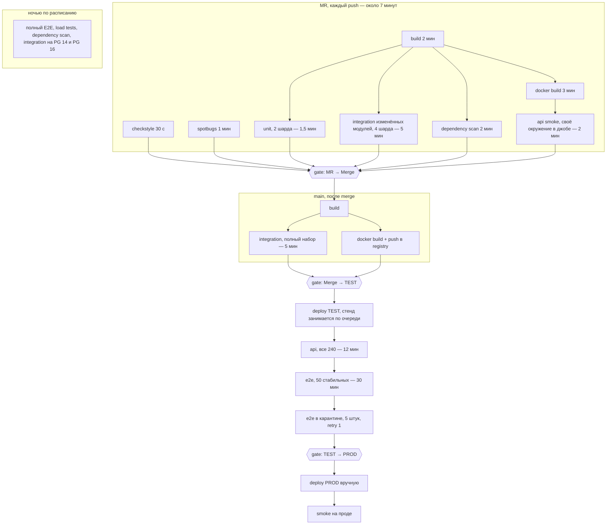

# pipeline HW

## Схема

## 1. Где запускается каждая проверка

| Проверка | Когда запускается | Blocking | Почему так |
|---|---|---|---|
| Checkstyle | MR, каждый push | да | 30 секунд, дешевле любого ревью |
| SpotBugs | MR | да | минута, ловит NPE и утечки до тестов |
| build (maven) | MR, main | да | без артефакта дальше гонять нечего |
| Unit, все 3600 | MR, main | да | 3 минуты на весь набор, режем на 2 шарда — полторы. Основная защита логики пересечений |
| Integration, только изменённые модули | MR | да | Полные 16 минут в SLA не влезают. Трогали `bookings` — гоним все тесты `bookings` целиком, а не выборочные |
| Integration, полный набор | main, ночью | да, для деплоя на TEST | 4 шарда ≈ 5 минут. Именно здесь поймали кейс 1 — пусть ловится хотя бы сразу после merge |
| API smoke, ~30 тестов | MR | да | 2 минуты на поднятом в джобе окружении. Проверяем, что приложение стартует и ключевые ручки живы |
| API, все 240 | main, на стенде | да, для релиза | 12 минут и стенд один — на каждый MR не повесить |
| E2E, 50 стабильных | main перед релизом и ночью | да, для релиза | 30 минут, общие данные, параллелить нельзя |
| E2E, 5 нестабильных | там же | см. раздел 4 | Отдельный джоб, чтобы их падения не красили весь набор |
| Dependency scan | MR, ночью на main | да на critical и high | 2 минуты. Кейс 2 случился ровно потому, что проверка была ручной |
| Docker build | MR параллельно с тестами, main с push в registry | да | 3 минуты. Dockerfile ломается не реже кода, а узнавать об этом на деплое поздно |
| Load tests | Раз в неделю по расписанию, вручную перед крупным релизом и перед сменой инфраструктуры | да для крупного релиза | 45 минут — в обычный цикл не встраивается |

Одна и та же группа тестов живёт на двух уровнях: в MR — срез по изменившимся модулям, в main — всё целиком.

Для 15–20 MR в день нужно держать 4–6 параллельных раннеров, иначе джобы встанут в очередь и 10 минут превратятся
в 20 — архитектура pipeline тут уже ни при чём.

## 2. Quality gates

### MR → Merge

Обязательно, иначе merge недоступен:

- checkstyle, spotbugs, build — зелёные;
- unit — все 3600 зелёные, падение одного блокирует;
- integration по изменённым модулям — зелёные;
- api smoke — зелёный;
- dependency scan — нет critical и high;
- 1 апрув, ветка актуальна относительно main.

Причина: до merge стоит дешевле всего. Сейчас же большая часть тестов запускается после влития — так и получился
кейс 1, когда сломанную проверку пересечений нашли уже в мастере.

### Merge → TEST

Раскатку на стенд останавливают:

- падение полного набора integration;
- неудачная сборка или push образа;
- ошибка миграции БД на стенде;
- стенд занят другим прогоном — деплой ждёт в очереди (`concurrency: test-stand`), а не ломится поверх.

Причина: на стенде стоят API и E2E.

### TEST → PROD

Релиз блокируют:

- любой из 50 стабильных E2E;
- повторное падение теста из карантина;
- падение полного набора API;
- critical или high в dependency scan;
- load tests не прогонялись после последнего изменения инфраструктуры или прошлый прогон не уложился в SLA
  (для крупных релизов);
- не прошёл smoke после деплоя — откат.

Причина: это последняя точка, где ошибка стоит дешевле, чем для пользователей. Деплой на прод остаётся ручным,
но кнопка доступна только на зелёном пайплайне.

## 3. Как уложились в 10 минут

Критический путь MR-пайплайна:

| Джоб | Старт | Длительность | Ждёт |
|---|---|---|---|
| checkstyle | 0:00 | 0:30 | — |
| spotbugs | 0:00 | 1:00 | — |
| build | 0:00 | 2:00 | — |
| unit, 2 шарда | 2:00 | 1:30 | build |
| integration по модулям, 4 шарда | 2:00 | 5:00 | build |
| dependency scan | 2:00 | 2:00 | build |
| docker build | 2:00 | 3:00 | build |
| api smoke | 5:00 | 2:00 | docker build |

Итого около 7 минут, остаётся запас на очередь раннеров.

Что для этого сделано:

- джобы связаны через `needs`, а не ждут всю стадию;
- unit и integration шардируются через `strategy.matrix`;
- в MR идут только тесты изменившихся модулей (`paths-filter`), полный набор — в main;
- API smoke поднимает приложение и зависимости в самом джобе, не трогая общий стенд;
- `concurrency` с `cancel-in-progress: true` — новый push отменяет предыдущий прогон;
- кэш `.m2` между джобами;
- тяжёлое (полный E2E, load, матрица версий PG) вынесено в ночные прогоны по расписанию.

## 4. Flaky-тесты

Пять нестабильных E2E живут в отдельном джобе с тегом `@quarantine`. Удалять их нельзя — это сценарии уведомлений
и асинхронной обработки, то есть ровно то место, где был реальный баг.

| Вопрос | Ответ |
|---|---|
| Блокируют ли release | Карантинные — нет. 50 стабильных — да, безусловно |
| Нужен ли retry | Да, но точечно: один повтор только для карантинного джоба. Весь набор ретраить нельзя — так прячутся настоящие падения |
| Что значит успешный retry | Только то, что pipeline не красный. Тест всё равно попадает в отчёт нестабильных, на падение заводится задача |
| Можно ли временно вынести из blocking gate | Можно — через карантин, но с задачей, владельцем и сроком в 2 недели. Без тикета тег не ставится |
| Что дальше | За 2 недели либо чинится, либо эскалация тимлиду. Два падения подряд в одном прогоне = падение считается настоящим и блокирует релиз |

Отдельно — вывод из кейса 3: одиночное падение больше не списывается на флак молча. Дежурный смотрит артефакты
и логи, и если причина не найдена, релиз не едет. Повторный прогон — не доказательство, что бага нет.

## 5. Повторяющиеся бронирования

Через месяц пользователь сможет создать серию броней на несколько недель вперёд. Для серии критична не сама
генерация дат, а поведение при конфликте: частично созданная серия хуже, чем несозданная.

| Сценарий | Уровень | Blocking |
|---|---|---|
| Генерация дат: каждый понедельник, каждую неделю, границы месяца и года | Unit | MR |
| Один слот из десяти занят → ни одна бронь серии не создана | Unit + Integration | MR |
| Ошибка в середине операции → в БД нет частичной серии, Kafka не получила событий по несозданным броням | Integration | MR |
| Два пользователя одновременно создают пересекающиеся серии → успех ровно у одного | Integration, реальная БД | MR |
| Повтор запроса на создание серии (ретрай клиента) → серия не задваивается | Integration | MR |
| Уведомления: одна серия — одно письмо, а не десять | Integration | MR |
| Создание серии через API, конфликт возвращает понятную ошибку с указанием занятого слота | API | Релиз |
| Создание серии → повторный поиск → занятые слоты пропали из выдачи | E2E | Релиз |

Что меняется в pipeline: новые тесты попадают в модуль `bookings`, то есть автоматически подтягиваются в MR при
его изменении. Время integration вырастет — добавим пятый шард. В ночной регресс идут три сценария: частичный
конфликт, гонка двух пользователей, обрыв на середине.

Сущность бронирования через два месяца начнёт обслуживать и рабочие места, поэтому новые тесты сразу пишем на
общую бизнес-логику, а не на «переговорки», — иначе через два месяца их придётся переписывать целиком.

## 6. Технические планы

| Изменение | Какие проверки нужны | Где гонять | Меняется ли окружение |
|---|---|---|---|
| PostgreSQL 14 → 16 | Полный integration на обеих версиях; прогон миграций на копии прод-схемы; проверка плана запросов поиска слотов | Матрица версий в ночном прогоне; миграции — отдельный джоб перед деплоем | Testcontainers поднимает обе версии без изменений. Стенд ещё 2–3 месяца на 14, поэтому API и E2E до апгрейда идут на 14 — это расхождение надо держать в голове |
| PROD 3 → 8 инстансов | Гонки при одновременном бронировании одного слота; отсутствие локального состояния в сервисе; инвалидация кеша Redis между инстансами; scheduled-задачи не дублируются | Integration с двумя репликами приложения; load tests на конфигурации, близкой к проду | Да. На TEST один инстанс, и многоинстансные гонки там не воспроизводятся — нужна возможность поднимать минимум две реплики |
| Больше Kafka consumers | Дубль сообщения → одно уведомление; падение консьюмера на середине → сообщение не потеряно; порядок событий по одной броне при партиционировании; DLQ и повторная обработка | Integration с Testcontainers, несколько консьюмеров в одной группе | Да, нужны несколько реплик консьюмера на стенде |

Перед PROD дополнительно: прогон миграции на дампе прода с замером времени и готовым откатом, load tests на новой
конфигурации инстансов, поэтапная раскатка и контроль метрики дублей уведомлений в первые часы после релиза.
